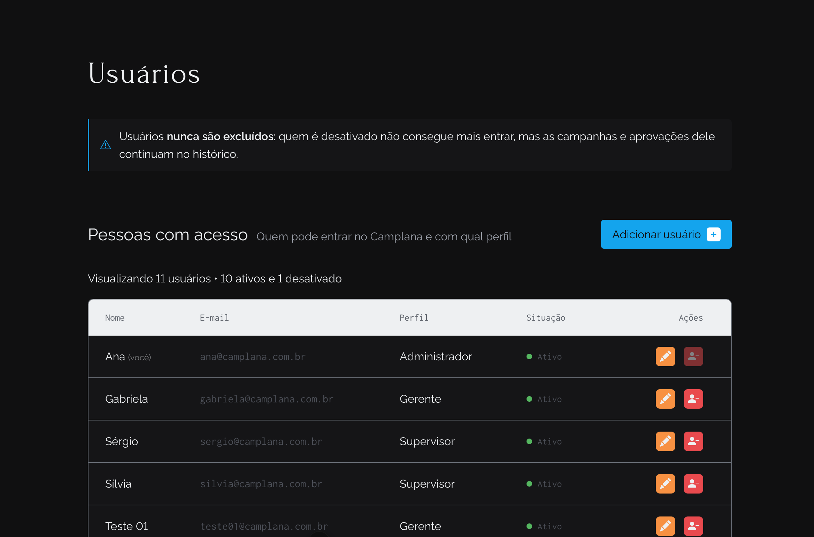
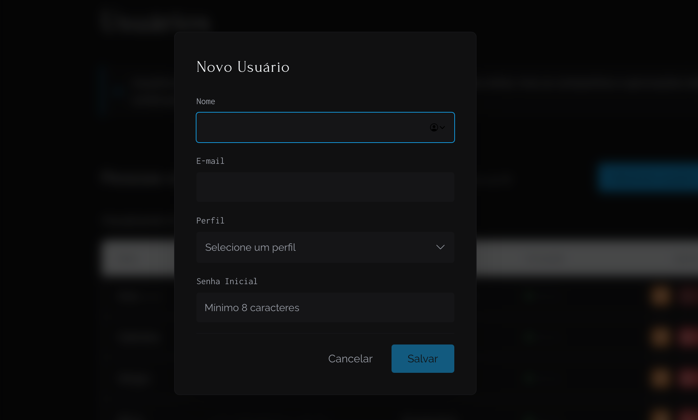
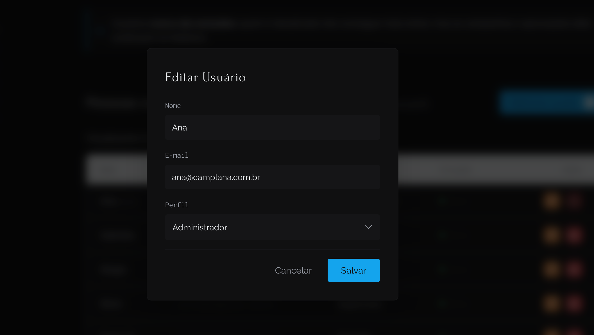
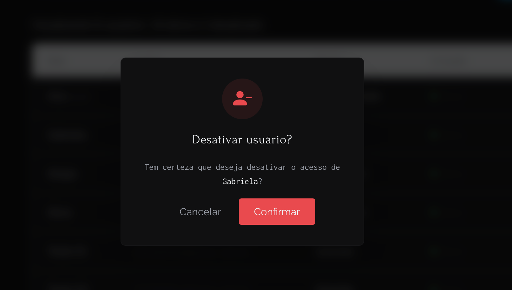

# Gerenciar Usuários
A tela de Gestão de Usuários é restrita ao perfil **Administrador**. Nela, é possível adicionar novas pessoas, editar dados e controlar quem tem acesso ao sistema.

### 1. Adicionar um Novo Usuário
1. No menu lateral, acesse **Usuários**.
2. Clique no botão azul **+ Adicionar usuário**.
3. Preencha o Nome e o E-mail.
4. Selecione o **Perfil** de acesso:
   * **Administrador:** Acesso total, incluindo esta tela de gestão.
   * **Gerente:** Acesso a criação de campanhas, chat e simulações.
   * **Supervisor:** Acesso às campanhas, decisões e importação de dados.
5. Defina uma senha inicial (mínimo de 8 caracteres).
6. Clique em **Salvar**. O usuário já poderá acessar o sistema imediatamente.

### 2. Editar Usuário
1. Na linha do usuário desejado, clique no botão laranja (lápis) na coluna "Ações".
2. Você pode alterar o Nome, E-mail ou Perfil. *(A senha não pode ser vista ou alterada por aqui)*.
3. Clique em **Salvar**.

### 3. Desativar ou Reativar Acesso
Usuários nunca são excluídos do sistema para preservar o histórico de campanhas e aprovações.
1. Na linha do usuário, clique no botão vermelho (Desativar) ou verde (Reativar) na coluna "Ações".
2. Confirme a ação no modal que aparecerá na tela.
> **Nota:** Por segurança, você não pode desativar a sua própria conta.

